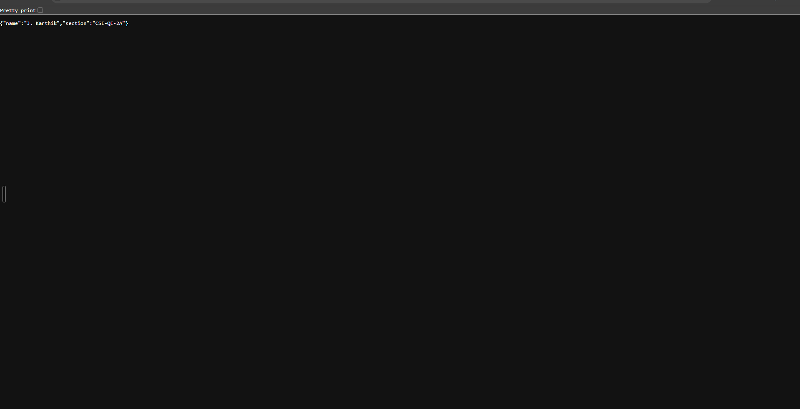

# Lab 1: Node.js and Express Server

## Student Details

- **Name:** J. Karthik
- **Registration Number:** 252U1R8030
- **Section:** CSE-QE-2A

## Live Link

**Live Application:** https://bdf-labs-t8dn.onrender.com

**GitHub Repository:** https://github.com/karthikjakkileti-rk/bdf-labs

## Objective

To create and deploy a basic web server using Node.js and Express.js. This application demonstrates HTTP routing, text responses, JSON responses, displaying the current date and time, and handling invalid routes using the HTTP 404 status code.

## Technologies Used

- Node.js
- Express.js
- JavaScript
- npm (Node Package Manager)
- Git and GitHub
- Render (deployment platform)

## How to Run the Project

### Prerequisites

Install Node.js and npm on your computer.

Check the installation:

```bash
node -v
npm -v
```

### 1. Clone the repository

```bash
git clone https://github.com/karthikjakkileti-rk/bdf-labs.git
```

### 2. Navigate to the project directory

```bash
cd bdf-labs
```

### 3. Install dependencies

```bash
npm install
```

### 4. Environment variables

The application uses the `PORT` environment variable when provided by the hosting platform. Otherwise, it uses port `3000`.

No additional environment variables are required.

### 5. Run the plain Node.js server

```bash
node server.js
```

Stop the server using `Ctrl + C` before starting the Express server.

### 6. Start the Express server

```bash
node express-server.js
```

The local server will be available at:

`http://localhost:3000`

## Endpoints Table

| Method | Endpoint | Description | Expected Status |
|---|---|---|---|
| GET | `/` | Returns the welcome message | 200 OK |
| GET | `/about` | Returns student details as JSON | 200 OK |
| GET | `/time` | Returns the current date and time | 200 OK |
| GET | `/unknown` | Tests handling of an invalid route | 404 Not Found |

## Live Endpoint Links

- [Home Route](https://bdf-labs-t8dn.onrender.com/)
- [About Route](https://bdf-labs-t8dn.onrender.com/about)
- [Time Route](https://bdf-labs-t8dn.onrender.com/time)
- [404 Error Test](https://bdf-labs-t8dn.onrender.com/unknown)

## Screenshots

The following screenshots demonstrate the application's output.

### 1. Home Route


### 2. About Route



### 3. Time Route


### 4. 404 Error Handling


## Problems Faced and Solutions

### 1. Setting Up the Node.js Server

**Problem:** Node.js could not find the server file because the filename used in the terminal did not match the actual filename.

**Solution:** Used the correct command, `node server.js`, to run the plain Node.js server.

### 2. Installing Express.js

**Problem:** The project required the Express.js framework to implement routes.

**Solution:** Installed Express using `npm install express` and verified the installation using `npm list express`.

### 3. Implementing Routes

**Problem:** The server needed to return different responses for different URL paths.

**Solution:** Created Express GET routes for the home page, about page, and current date and time.

### 4. Handling Invalid Routes

**Problem:** Requests to unknown URLs needed to return an appropriate error response.

**Solution:** Added fallback middleware that returns a 404 status code and a page-not-found message.

### 5. Deploying the Application

**Problem:** The application needed to be accessible through a public URL.

**Solution:** Uploaded the project to GitHub and deployed the Express server using Render.

## Conclusion

This lab provided practical experience in creating web servers using Node.js and Express.js. It helped develop an understanding of HTTP requests and responses, route handling, JSON output, date and time operations, HTTP status codes, package management, Git version control, and cloud deployment using Render.
